<p align="center">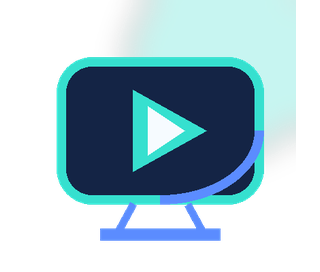</p>

# IMD TV

**Live TV, films and series on Android TV ΓÇö free and open source.**

[](https://github.com/HDSGASDA/app-perfect-tv/releases)

IMD TV is a player for your own IPTV playlist (Xtream login, M3U link or Stalker portal). It has a fast TV guide that keeps up with
the remote, movies and series with posters and subtitles, six themes, and no ads or tracking.

Website: https://imd-tv.com

> IMD TV is a media player. It does not provide, sell or link to any channels or content ΓÇö use the playlist you
> already have from your provider.

## Features

- **TV guide** ΓÇö seven days of programmes, and free open-source guides (epgshare01) for channels your provider leaves blank.
- **Movies & series** ΓÇö posters, plots, seasons and episodes, resume where you left off, embedded subtitles in your language.
- **Search** ΓÇö channels, films and series in one search, or within a single category.
- **Playlists** ΓÇö Xtream logins, M3U links and Stalker portals (beta). Add several, name them, switch in Settings.
- **Your categories** ΓÇö favourites, your own groups, hide what you never watch (whole categories or ticked channels in bulk), reorder the rest.
- **DRM** ΓÇö M3U channels protected with ClearKey or Widevine play.
- **Recording** ΓÇö record live TV now or schedule a programme from the guide, to the box, a USB drive or a network
  share (SMB), and watch it later with resume. Turn it on in Settings › Playback › Recording.
- **Channel logos** ΓÇö open-source logos (tv-logos), your playlist's, or your own logo pack.
- **Six themes** ΓÇö Celestial Glass, Celestial +, Celestial Retro, Liquid Glass, Xcube 360 and Gamestation.
- **Backup & restore** ΓÇö move your setup to a new box; logins are never written to the backup file.
- **Private** ΓÇö no accounts, no ads, no analytics. Logins are encrypted on the device.

## Screenshots

Six themes, all with the same fast guide:

| | |
|---|---|
| 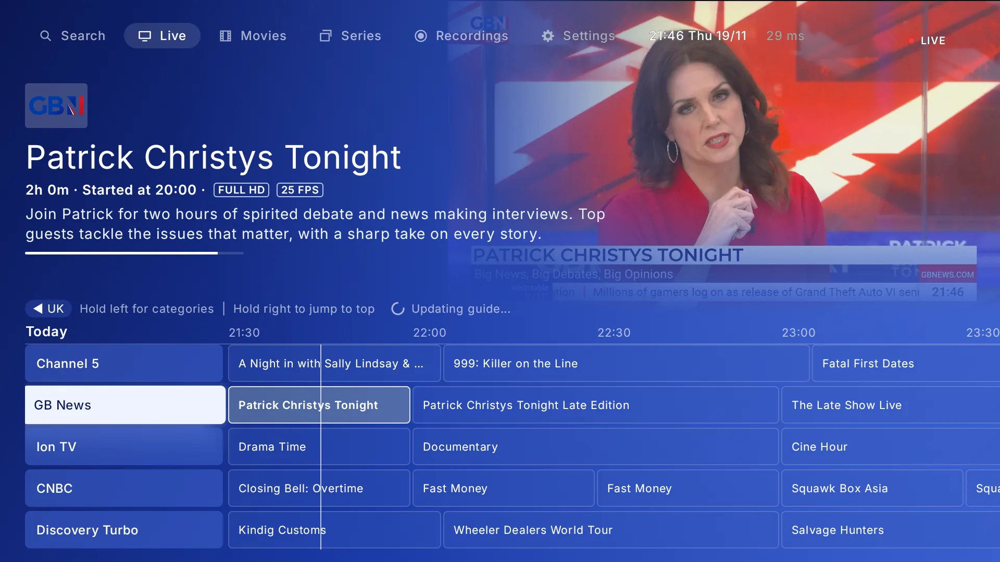 Celestial Glass | 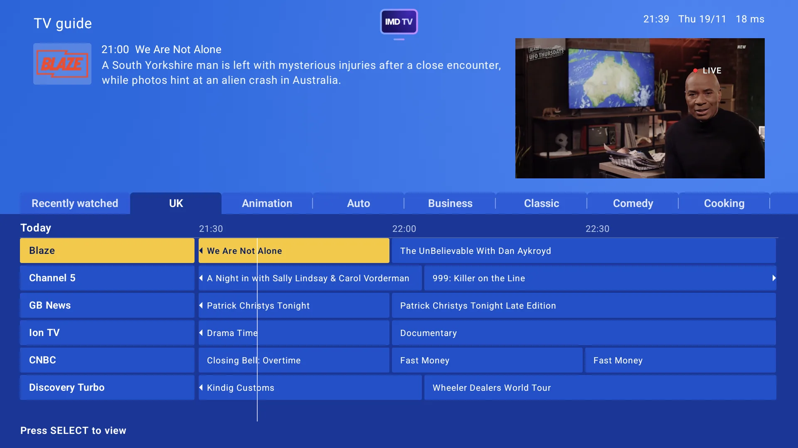 Celestial + |
| 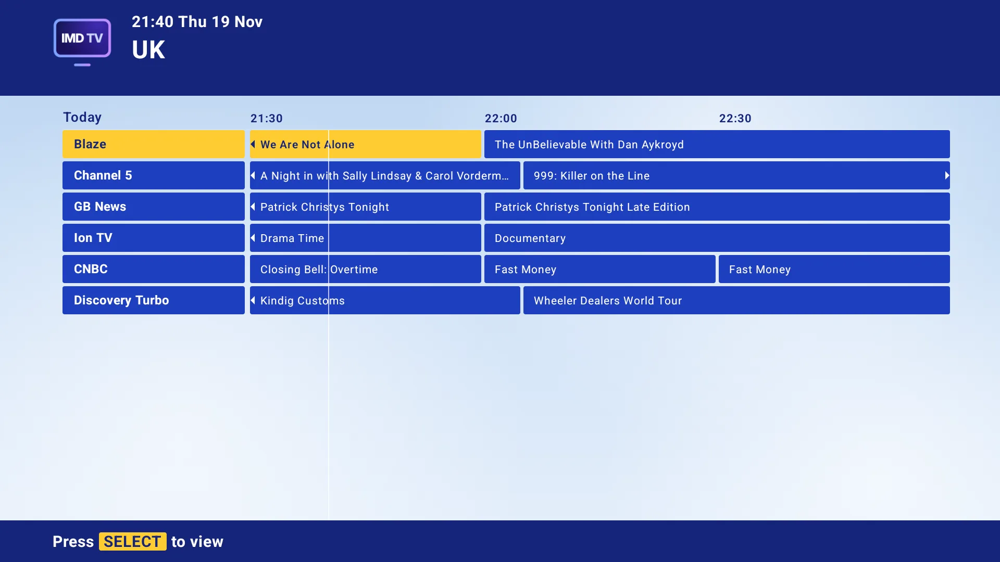 Celestial Retro | 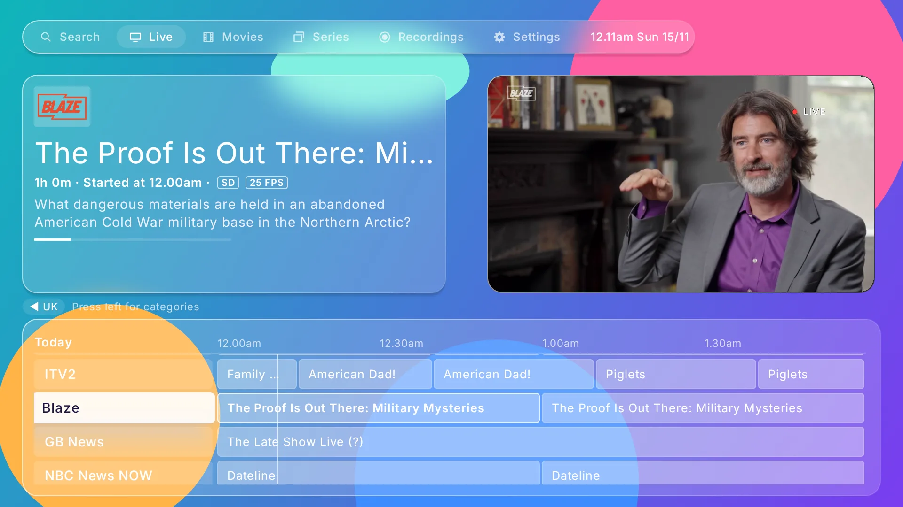 Liquid Glass |
| 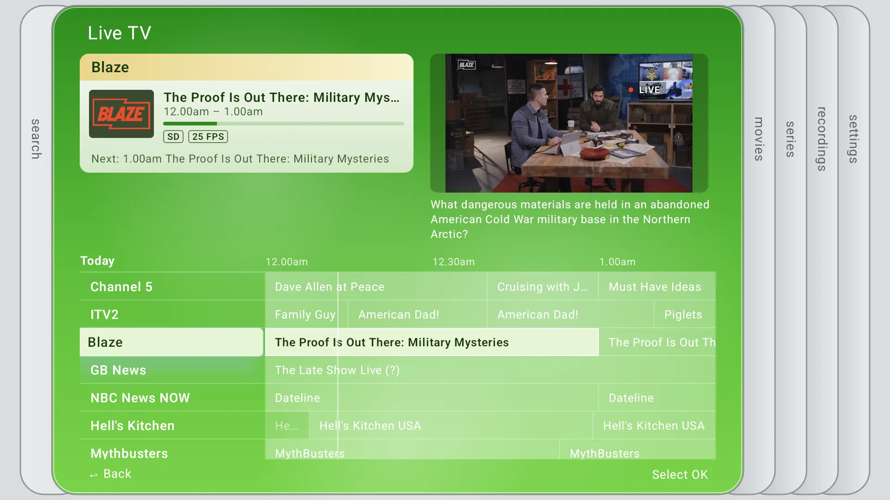 Xcube 360 | 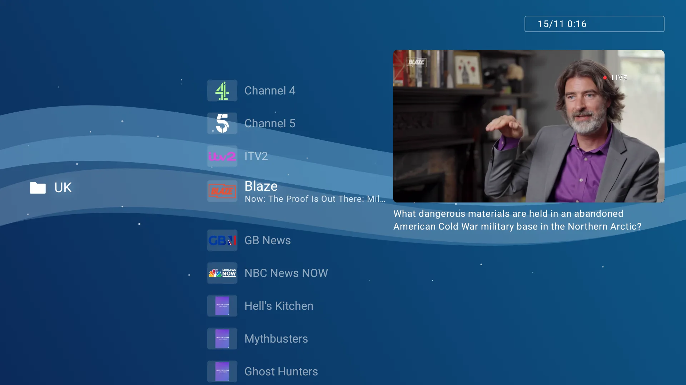 Gamestation |

| | |
|---|---|
| 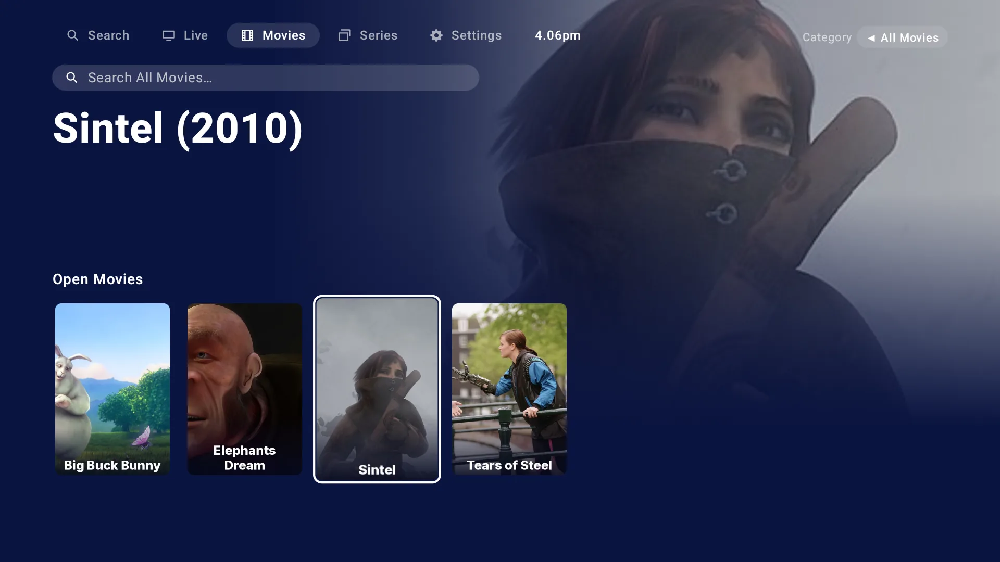 Movies | 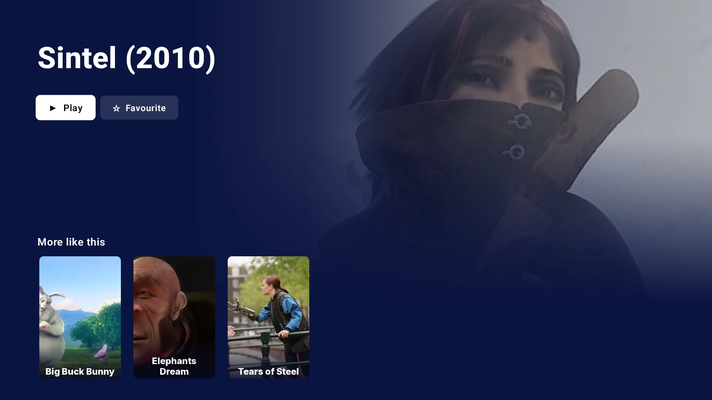 Movie details |
| 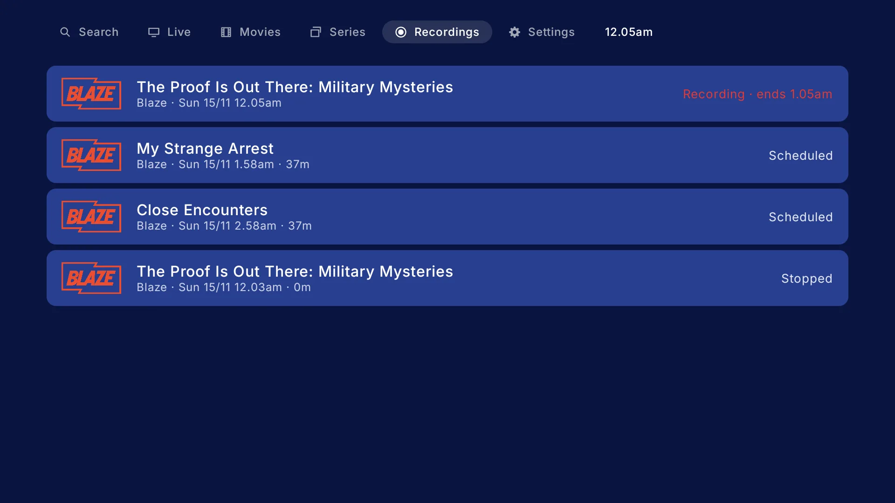 Recordings | 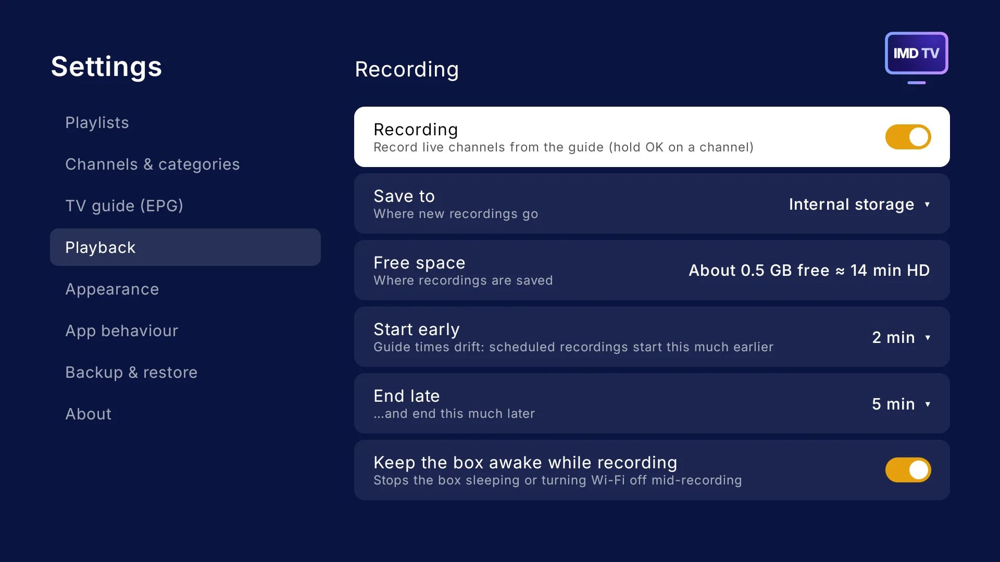 Recording settings |

## Recording: known limitations

- A box in deep standby may not wake for a scheduled recording; it is then marked "Missed". If the box wakes while the
  programme is still on, the rest is recorded.
- Recording one channel while watching another needs two connections from your provider. Xtream logins report their
  limit and the app asks before it stops one; with M3U playlists and Stalker portals the app just tries, and the recording fails if the
  provider refuses a second stream. (Recording the channel you're watching needs two connections too.)
- Internal storage on small boxes holds only a few hours (a Chromecast with Google TV: about 2 hours of HD). Use a USB
  drive or a network share.
- Recordings on the box or a USB drive are removed if you uninstall the app (they live in the app's own folder; on a
  USB drive that's `Android/data/org.imdtv.iptvtv/files/Recordings`). Network-share recordings stay.
- DASH and encrypted streams can't be recorded. Recordings are saved as received (`.ts`), not converted.
- No live pause and no series recording.

## Install

Requires Android TV / Google TV **8.0 or newer** (tested on Chromecast with Google TV and a Thomson 140 stick).

### Option 1: Downloader (on the TV)

1. On your TV, install the free **Downloader** app from the Play Store.
2. Open Downloader, type the code `7573990` and press Go. When asked, allow Downloader to install apps, then choose Install.
3. Open IMD TV and add your Xtream login, M3U link or Stalker portal.

### Option 2: Sideloading (from a computer)

1. Download `imd-tv.apk` from [Releases](#releases) on your computer.
2. On the TV, turn on Developer options and USB or network debugging, then run `adb connect <your TV's IP>` and
   `adb install imd-tv.apk`. Or copy the file to a USB drive and open it with a file manager app on the TV.
3. Open IMD TV and add your Xtream login, M3U link or Stalker portal.

## Cloudflare hosting

Cloudflare Pages, the managed-app API and optional R2 APK delivery can be set up using the free-tier options. See [CLOUDFLARE_SETUP.md](CLOUDFLARE_SETUP.md) for setup instructions, limits and the free-first design.

Android APKs are published automatically to GitHub Releases when a `v*` version tag is pushed. See [RELEASES.md](RELEASES.md) for the one-time signing setup and release procedure.

## Build from source

You need JDK 17 and the Android SDK (platform 35), or Android Studio.

```sh
./gradlew assembleRelease   # app/build/outputs/apk/release/app-release.apk
./gradlew testDebugUnitTest # unit tests
```

Release builds are signed with the key described in `~/.config/iptv-tv/keystore.properties` (path overridable with
`IPTV_KEYSTORE_PROPERTIES`); without it they fall back to the debug key.

## Support

IMD TV is free and always will be. If it's useful to you, you can
[buy me a coffee](https://buymeacoffee.com/majorleeevil) ΓÇö entirely optional.

## Contact

support@imd-tv.com

## Licence

[GPL-3.0](LICENSE). You may use, study, change and share IMD TV; shared changes must stay under the same licence.

## Releases

- **Latest:** [imd-tv.apk](https://github.com/HDSGASDA/app-perfect-tv/releases/latest/download/imd-tv.apk)
  (always the newest version)
- **All versions and change notes:** [github.com/HDSGASDA/app-perfect-tv/releases](https://github.com/HDSGASDA/app-perfect-tv/releases)
